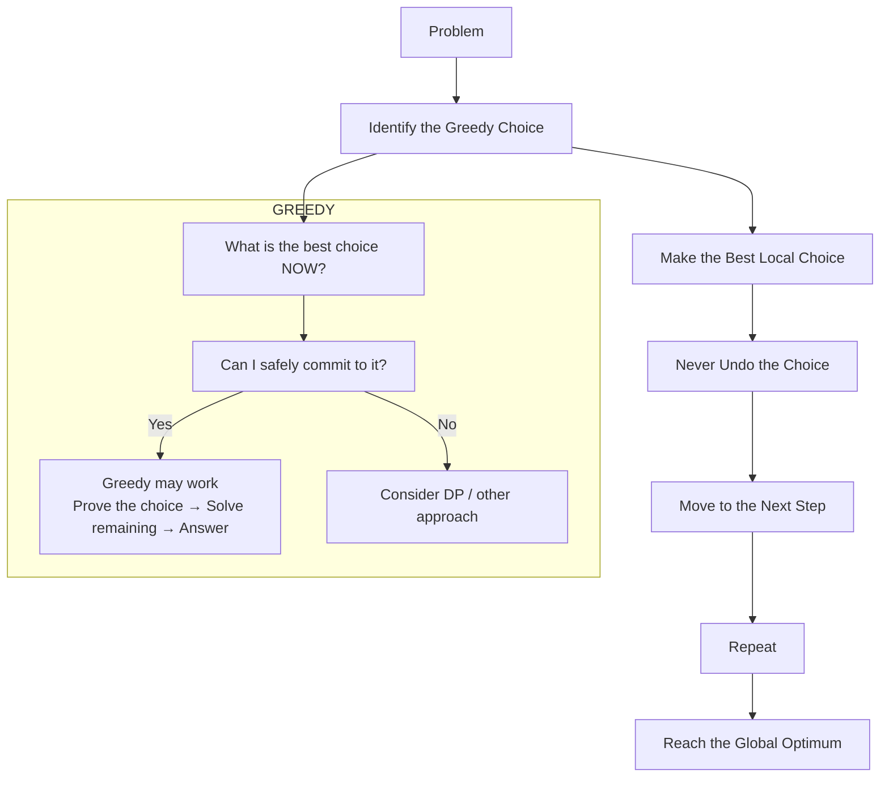

# Greedy Mental Model

A concise mental model for solving problems with a greedy approach.



## Process (step-by-step)

1. Identify the greedy choice for the current step.
2. Make the best local choice available now.
3. Never undo earlier greedy choices.
4. Move to the next step and repeat.
5. Continue until you reach the global optimum.

## Decision Checklist

- **Ask:** What is the best choice NOW?
- **Verify:** Can I safely commit to it (without needing to undo later)?
- **If yes:** Prove the greedy choice leads to an optimal solution, then solve the remaining subproblems.
- **If no:** Consider dynamic programming or another global approach.

## Notes

- Greedy works when the greedy-choice property and optimal substructure hold.
- Always try to justify the greedy choice with a proof or exchange argument.

---

Original ASCII diagram preserved for reference:

```text
Problem
   ↓
Identify the Greedy Choice
   ↓
Make the Best Local Choice
   ↓
Never Undo the Choice
   ↓
Move to the Next Step
   ↓
Repeat
   ↓
Reach the Global Optimum

============================
                 GREEDY
                    │
                    ↓
        What is the best choice NOW?
                    │
                    ↓
        Can I safely commit to it?
                    │
             ┌──────┴──────┐
             │             │
            YES            NO
             │             │
             ↓             ↓
        Greedy may       Consider DP /
          work           other approach
             │
             ↓
       Prove the choice
             │
             ↓
       Solve remaining
             │
             ↓
          Answer
```
